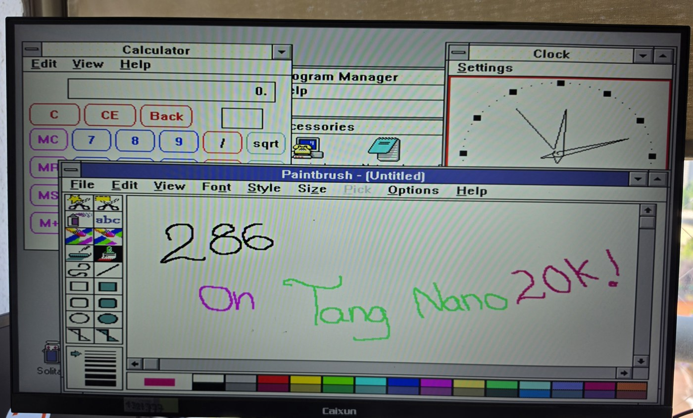
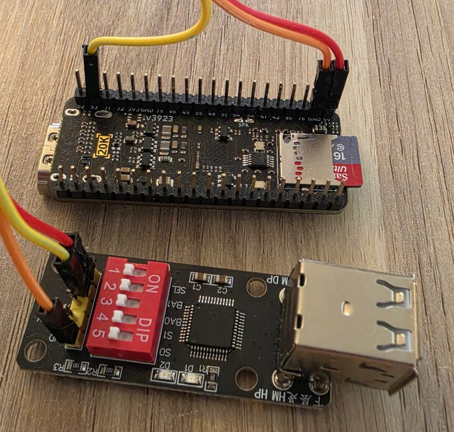

# 286 on the Tang Nano 20K

A PC with an 80286, built to fit a Sipeed Tang Nano 20K (GW2AR-18). It is not a copy of
the PC/AT: the CPU is real (SPK286), the rest is a small chipset of our own with the
ports PC software expects. The goal is DOS and games.

Status: work in progress. In simulation the machine boots FreeDOS from an SD card image
(floppy or hard disk). On the board it boots FreeDOS, runs games (Monkey Island, Lotus,
SkyRoads, Commander Keen 4) and Windows 3.1 in standard mode, with the mouse. Another computer
can type, read the screen and copy files to and from its disk over the USB cable.

## What you need

| Item | Notes |
|---|---|
| Sipeed Tang Nano 20K | the FPGA board (GW2AR-18). HDMI, the SD card slot, 8 MB of SDRAM and the USB port are all on it |
| USB keyboard adapter | a CH9350 USB host module, or a Raspberry Pi Pico acting as one: the board has no USB port for a keyboard |
| USB keyboard, and a mouse if wanted | plugged into the adapter |
| Micro SD card | any size; the machine uses up to 2 GB of it |
| HDMI monitor and cable | 640x480 at 60 Hz, with sound |
| USB-C cable | power, flashing, and the PC link to another computer |
| Three jumper wires | adapter to the board's header |

The Tang Nano 20K (top) and a CH9350 module (bottom). Three wires join them:

| Adapter | Tang Nano 20K header |
|---|---|
| 5V | 5V |
| GND | GND (any) |
| TX (TXD) | pin 53 |

The pin numbers are printed on the underside of the board. Nothing else is connected: no
resistors, and the adapter's RX stays free. The adapter sends the keyboard's and the mouse's
USB reports as CH9350 frames (115200 baud, 8N1), which the FPGA turns into PC scancodes and
mouse movement.

- **CH9350 module:** set its switches to host mode, state 0 (data sent as it comes), 115200
  baud. Keyboard and mouse go into its two USB sockets.
- **Raspberry Pi Pico:** it must be programmed to be a USB host (TinyUSB) and to send each
  report as a CH9350 frame on its UART TX at 115200 baud; the frames are described at the top
  of `rtl/kbd_ch9350.sv`. The keyboard goes on the Pico's USB socket with an OTG adapter.

On the board, button S1 is the reset button. Flash the bitstream from the
[releases](https://github.com/carlosbravoa/286-on-tang-nano20k/releases) with
`openFPGALoader -b tangnano20k -f pc286-vX.Y.Z.fs`, write the card image to the SD card (see
below), and the machine boots FreeDOS.

## The machine

| Part | How |
|---|---|
| CPU | [SPK286](https://github.com/aitorgomez-net/SPK286), unmodified, in `ref/SPK286`. The hardware task switch is left out of the build and replaced by a stand-in that faults (`rtl/cpu_trim`); `NOLOADALL=1` leaves LOADALL out as well (about 3,900 logic cells less in all), `FULLCPU=1` builds the whole CPU |
| RAM | the board's 8 MB SDRAM: 640 KB, plain RAM at C0000-FBFFF, 6.75 MB above 1 MB; a 32 KB cache in block RAM in front of it (`rtl/sdram_bridge.sv`) |
| BIOS | our own (`bios/`), 16 KB in block RAM at FC000 |
| Video | text 40x25 and 80x25, CGA 320x200x4 and 640x200x2, VGA 320x200x256 (mode 13h) with the VGA palette, EGA/VGA 16 colours in four planes (modes 0Dh, 0Eh, 10h, 12h: write modes 0-3, set/reset, bit mask, functions, both read modes, start address, line length, pixel panning, split screen, palette registers; `rtl/ega_planes.sv`); 640x480 at 60 Hz on HDMI, or 640x400 at 70 Hz as a VGA card sends it (`make bitstream LINES=449`) (`rtl/video.sv`) |
| Keyboard | CH9350 (or a Pico acting as one) on pin 53, as on the Atari816; turned into set 1 scancodes at ports 60h/64h |
| Mouse | the same CH9350; the driver (INT 33h) is in the BIOS, and so is the interface of a PS/2 mouse (INT 15h AH=C2h), which Windows uses |
| Disk | SD card on an SPI port (E0h/E1h); the BIOS reads and writes sectors itself. Drive B: is served by another computer over the PC link |
| AdLib | OPL2 at 388h/389h ([JTOPL](https://github.com/jotego/jtopl), `rtl/jtopl`), mixed with the speaker into the HDMI sound |
| Sound Blaster | version 2.0 at 220h, IRQ 7, DMA 1: 8-bit sound, direct or through DMA (`rtl/sblaster.sv`, with the one DMA channel it needs); no recording, MIDI or compressed sound |
| Timer, interrupts, speaker | 8254 (channels 0 and 2), two 8259s, port 61h; the speaker is heard over HDMI |
| PC link | a monitor on the USB serial port types keys, moves the mouse, reads and writes RAM, resets the machine and copies files to and from its disk (`rtl/monitor.sv`, `tools/pc286ctl.py`; see below and [docs/pc-link.md](docs/pc-link.md)) |
| Memory window | D0000-DFFFF can show any four 16 KB pages of the 8 MB (ports ECh-EEh): the BIOS copies to and from extended memory with it (INT 15h AH=87h), expanded memory will use it |

There is no second processor: everything the machine needs is logic or x86 code in the BIOS.

A program can come back from protected mode by a CPU reset, as on the AT: CMOS byte 0Fh
(ports 70h/71h, without the clock) with methods 05h, 09h and 0Ah (`tests/pmtest.asm`).
Windows 3.1 runs in standard mode, on the board too (`docs/windows31-sim.png` is the
simulator's picture): on FreeDOS with Microsoft's HIMEM.SYS, which needs the CPU's LOADALL;
VGA 640x480 in 16 colours, the PS/2 mouse driver. Windows refuses other XMS drivers.
The clock is the BIOS' (INT 1Ah): the time of day is its tick count, the date is kept beside it;
both live through a reset, not through power off, and the PC link sets them. Not there yet:
expanded memory. In the 16-colour modes: no data
rotate; BIOS text there is 8x8 in the top 25 rows.
The planes take the top 256 KB of the SDRAM (6.75 MB of extended memory are left).

## SD card

    make card                                           # build/card.img, 128 MB
    make card CARD_MB=2016                              # up to 2 GB
    sudo dd if=build/card.img of=/dev/sdX bs=1M conv=fsync   # the whole card is overwritten

The image is drive C: with FreeDOS, the XMS driver (FDXMS286: DOS loads high, 618 KB free)
and everything in `dos-disk/` (not in git; one directory per program). It boots from C:.
It sets `BLASTER` and runs `MOUSE.COM` (`dos/mouse.asm`): the mouse driver is in the BIOS, but DOS
takes its interrupt vectors at start, and this has the BIOS put them back (INT 15h, AX=C2FFh).

Layout: sector 0 is the partition table (one FAT16 partition from sector 4032, up to 2 GB);
sector 64 can hold a floppy image, which is then drive A: and is booted first. C: is an
ordinary partition: it can be mounted on a PC to copy files. Files can also be sent to a card
that is in the machine: `tools/pc286ctl.py put FILE C:/DIR` (see the PC link below).

    tools/mkhd.py build/hd.img --size-mb 64 --from FLOPPY.img --root dos-disk --xms FDXMS286.SYS
    tools/mkcard.py build/card.img --hd build/hd.img [--floppy FLOPPY.img]
    tools/fatimg.py build/card.img@4032 put FILE        # add a file to C: (@64: to A:)

Needs in `ref/dos/` (not in git): the FreeDOS 1.3 boot floppy and the FDXMS286 package.

Windows: install it once (on a PC emulator, onto `build/hd.img`), copy its directory to
`dos-disk/WINDOWS`, and `make card` does the rest: with `WINDOWS/HIMEM.SYS` there, the card
loads that driver and not FDXMS286, and `C:\WINDOWS` is on the path. Then `win`.

## PC link: remote control and file transfer

The board's USB cable carries a serial port (115200 8N1). It sends the BIOS' text and takes
commands for a small monitor in the FPGA, which `tools/pc286ctl.py` on the other computer
talks to. The monitor is hardware beside the CPU, so keys, mouse, screen and memory work
whatever the machine runs. The full guide is [docs/pc-link.md](docs/pc-link.md).

    tools/pc286ctl.py ping                            # is the machine there?
    tools/pc286ctl.py type 'dir\r'                    # keys
    tools/pc286ctl.py key ctrl-alt-del
    tools/pc286ctl.py screen                          # the text screen
    tools/pc286ctl.py wait 'C:\>' 60                  # until that text is on the screen
    tools/pc286ctl.py shot picture.png                # a graphics screen
    tools/pc286ctl.py mouse 20 -5                     # and click
    tools/pc286ctl.py peek 40:17 2                    # RAM; also poke, save and load a file
    tools/pc286ctl.py clock                           # set the date and time to this computer's
    tools/pc286ctl.py reset

Files, with the machine at the DOS prompt:

    tools/pc286ctl.py put game.zip mygame/ C:/GAMES   # files and whole directories
    tools/pc286ctl.py get 'C:/GAMES/SAVE*.DAT' saves/
    tools/pc286ctl.py serve disk.img                  # be drive B: with a FAT image

They go through a drive B: that has no hardware: the BIOS leaves each request in its data
area, and the tool reads and writes the machine's memory through the monitor. About 8 to
11 KB a second to the machine and 5 KB a second back; names must be 8.3.

The port is `--port`, else `$PC286_PORT`, else `/dev/ttyUSB1`. Only RAM is read: not the ROM,
not the video registers (a picture has the BIOS' colours and starts at the start of video
memory). The same tool talks to the simulator: `build/simsys --pty build/pty ...`, then
`--port build/pty --timeout 300`.

## Directories

- `rtl/` the machine; `rtl/board/` what is specific to the Tang Nano 20K (clocks, SDRAM, HDMI:
  the blocks proven by the Atari816 project)
- `bios/` the BIOS (NASM)
- `sim/` the simulator (Verilator): RAM, an SD card, a CH9350 keyboard and the serial port as models
- `tools/` card and hard disk images, a FAT tool, the remote control, the keyboard table, the palette
- `tests/` small boot sectors that test one thing each (video modes, mouse, memory move,
  protected mode, sound, the clock, the PC link and its drive B:), and `tests/run.py`, which runs them all
  in the simulator
- `docs/` the PC link guide, pictures
- `board/` pins, timing constraints, the Gowin build script
- `fit/` the first measurements (SPK286 alone on this FPGA)
- `ref/` reference repositories and DOS images (not in git; see below)

## Building

Needs: Verilator 5, NASM, Python 3, the Gowin IDE (for the bitstream).

    git clone https://github.com/aitorgomez-net/SPK286 ref/SPK286
    make sim                 # the BIOS and the fast simulator (build/sim)
    make build/simsys        # the whole system with video (build/simsys), slower
    make bitstream           # Gowin: build/gowin/pc286/impl/pnr/pc286.fs
    make bitstream LINES=449 # the same with the 640x400 at 70 Hz raster

    build/sim --sd build/card.img --screen --expect 'A:\>' --type 'dir\r'
    build/simsys --sd build/card.img --cycles 9000000 --ppm frame.ppm
    tests/run.py             # all the tests: about 10 minutes

## Licences

The project is free software under the GNU General Public License, version 3 or (at your
option) any later version; the text is in `LICENSE`. Parts by others keep their own licences, all
compatible with it: `rtl/board/sdram_nestang.v` is Apache-2.0
(nand2mario), `rtl/board/hdmi/` is MIT (hdl-util/hdmi), `rtl/jtopl/` is GPL-3.0 (Jose Tejada), `rtl/board/gw2ar_sdram.sv` is GPL-3.0-or-later (or CC-BY-NC-SA-4.0),
SPK286 (not in this repository: clone it into `ref/SPK286`) is MIT, the fonts come from the
SeaBIOS VGA BIOS (see `fonts/README.md`).
